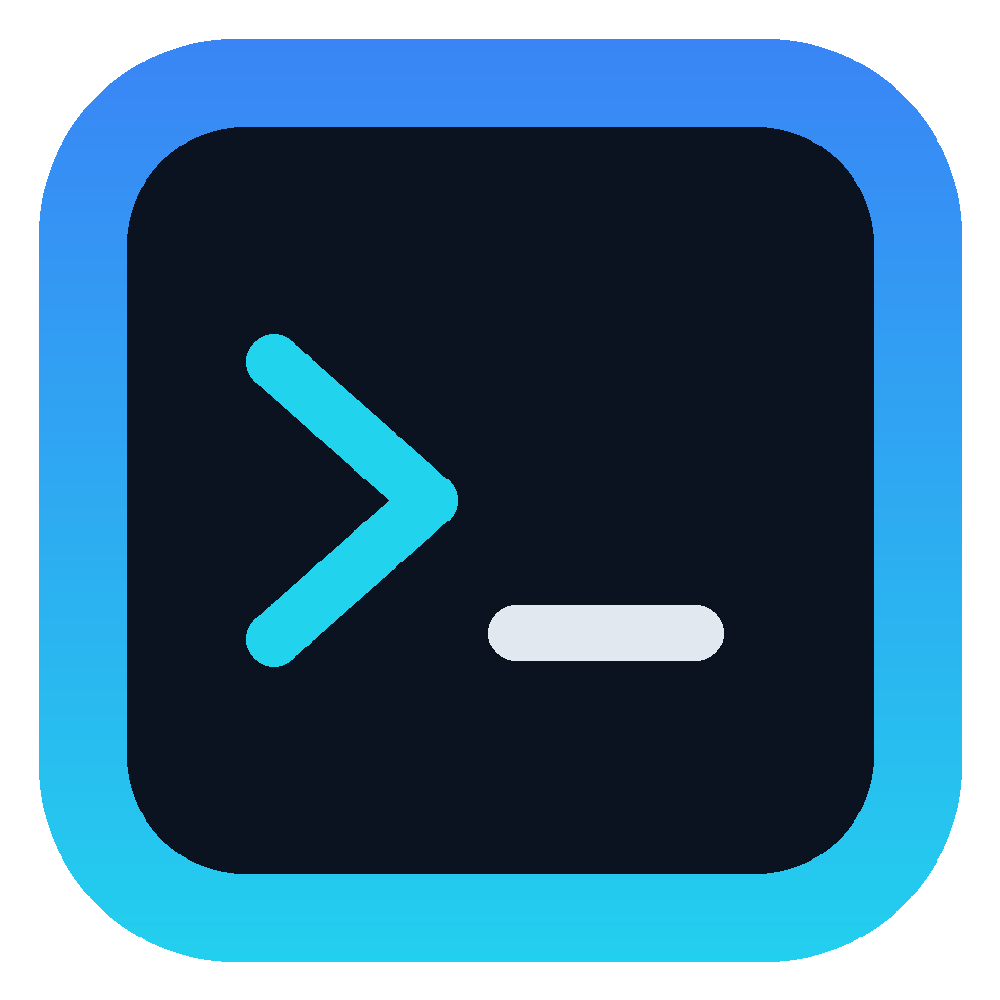

<p align="center">
  
</p>

<h1 align="center">NEXTERM</h1>

<p align="center">
  <b>The Windows terminal and IT support toolkit.</b><br/>
  Free and open source (MIT).
</p>

NEXTERM combines a modern multi-tab terminal with a one-click library of real Windows diagnostics. **Easy Mode** gives help-desk staff and everyday users plain-language buttons, and **Advanced Mode** gives admins and developers the terminal, raw commands and every tool.

> **Status: v0.1 (Phase 1 MVP).** The features listed under “Working now” are implemented. Items marked *planned* are not in this release yet.

---

## Install

**One command** (PowerShell, Windows Terminal or Command Prompt):

```powershell
powershell -c "irm https://raw.githubusercontent.com/renzoae/nexterm/main/install.ps1 | iex"
```

This downloads the latest release from GitHub, verifies its SHA-256 checksum, and installs NEXTERM for the current user. No admin rights are needed. You can read the script first: [`install.ps1`](install.ps1).

**Or download manually:**

1. Open the [**Releases**](../../releases) page.
2. Download one of:
   - `NEXTERM-Setup-x.y.z.exe`: installer (per-user, no admin needed)
   - `NEXTERM-x.y.z-portable.exe`: run without installing
3. Windows SmartScreen may warn that the app is unrecognised because builds are not code-signed yet. Click **More info › Run anyway**. You can verify the file against `SHA256SUMS.txt` on the release page.

Requirements: Windows 10 1809+ or Windows 11, x64.

---

## Working now

| Area | What works |
|---|---|
| **UI** | Dark and light themes, collapsible sidebar, command palette (`Ctrl+K`), customisable dashboard, Easy/Advanced mode switch (`Ctrl+Shift+E`), Windows 11 title bar |
| **Terminal** | Real shells via xterm.js + node-pty (ConPTY): Windows PowerShell, PowerShell 7, Command Prompt, every WSL distro, Git Bash. Tabs, split panes (up to 4, resizable), output search, copy/paste, right-click copy/paste, clickable links, 4 colour schemes, font, size, cursor and scrollback settings. Sessions are killed when closed. |
| **Dashboard** | Live CPU and memory graphs, OS, uptime, disks, network status, privilege level, quick fixes |
| **IT Support Toolkit** | 85 real commands in 12 categories. Each one shows its name, description, exact command, admin requirement, risk level, parameters, a Run/Stop button, streaming output with filter and copy, exit status and duration. |
| **Network** | Adapter table, IPs, MACs, link speed, DHCP, gateway, DNS servers per interface, live internet reachability (TCP) and DNS resolution checks. Tools include ipconfig (all, flushdns, release, renew), ping, tracert, nslookup, Resolve-DnsName, netstat, arp, getmac, route, Test-NetConnection, Get-NetAdapter, Get-NetIPAddress, Wi-Fi status and Winsock reset. |
| **Windows Troubleshooting** | systeminfo, sfc, DISM check/restore, chkdsk /scan, tasklist, driverquery, Get-ComputerInfo, services, failed auto-start services, processes, hotfixes, event logs, last-24h errors, Windows Update services, gpupdate, restart Explorer. Also one-click launchers for Device Manager, Event Viewer, Services, Disk Management, Computer Management, Resource Monitor, Performance Monitor, Network Connections, Windows Update, Task Manager and more. |
| **Hardware** | CPU (per-thread load), memory, GPUs, physical disks with SMART status, volumes, uptime, and a live process list. All values are read from Windows; nothing is simulated. |
| **Users & AD** | whoami (/groups, /priv), net user, local admins, Get-LocalUser, gpresult. Domain detection, DC locator, secure channel test, Kerberos tickets, and an RSAT account lookup. These only run when the PC is actually domain-joined. |
| **Security checks** | Defender status, firewall profiles, listening ports with process names, UAC, BitLocker, Secure Boot, TPM |
| **Remote** | Saved SSH profiles (opened in a terminal tab with Windows OpenSSH, key-file support, **no passwords stored**), Remote Desktop launcher, connection history |
| **Software** | winget search, installed list, available updates, and install/update/uninstall. Each action shows the exact command and asks for confirmation. |
| **Developer** | Detects Git, Node.js, npm, Python, PowerShell 7, Docker, WSL, winget and VS Code, and gives a one-line install hint for anything missing. Also includes a JSON formatter and Git/Docker/Python/npm commands. |
| **Command Library** | Searchable database filtered by category, shell, risk level and admin requirement, with Run, Copy and “send to terminal” |
| **Activity log** | Every command, launch and terminal session is logged with its result. Command output, keystrokes and passwords are never logged. |

## Planned

| Phase | Items |
|---|---|
| 2 | Session restore, custom terminal profiles, command-history panel |
| 3 | Event log viewer UI, service start/stop management, SFTP browser, remote PowerShell |
| 4 | Monaco editor, project explorer, Git operations, **AI assistant** (optional, bring your own key, never auto-executes) |
| 5 | Code signing, auto-update, more automated tests, Arabic UI with RTL |

---

## Security model

NEXTERM runs system commands, so security is part of the design:

- **No arbitrary execution from the UI.** The renderer can only send a *command id* from the built-in registry plus parameters. The main process validates every parameter against a strict allow-list (host names, ports, drive letters, fixed choices), builds the argv itself, and runs it **without a shell**. PowerShell scripts are passed with `-EncodedCommand`, and string parameters become escaped literals. Injection attempts are covered by unit tests.
- **Terminals** can only start shells that NEXTERM detected (PowerShell, CMD, WSL, Git Bash, ssh). The renderer never supplies an executable path.
- **Electron hardening:** context isolation on, Node integration off, sandboxed renderer, strict CSP, navigation and popups blocked, all permission requests denied, IPC sender checked and arguments validated with zod.
- **Confirmations come from the main process.** Every tool that changes the system (risk “caution” or “high”) and every winget action shows a native dialog with the exact command, so a compromised renderer cannot skip it.
- **No silent elevation.** NEXTERM runs as a standard user (`asInvoker`). Admin tools open a separate elevated PowerShell window only after a confirmation dialog and the Windows UAC prompt.
- **No secrets stored.** SSH profiles keep host, user, port and key path only.
- System executables are resolved from `%SystemRoot%\System32`, and PATH lookups ignore relative directories.

Please report vulnerabilities privately; see [SECURITY.md](SECURITY.md).

---

## Build from source (Windows)

```powershell
# 1. Install prerequisites (once)
winget install --id OpenJS.NodeJS.LTS -e
winget install --id Git.Git -e

# 2. Get the code
git clone https://github.com/renzoae/nexterm.git
cd nexterm
npm ci

# 3. Run in development mode (hot reload)
npm run dev

# 4. Checks
npm run check        # typecheck + lint + unit tests

# 5. Build the installer and portable exe into .\release
npm run dist:win
```

No Visual Studio build tools are needed, because the terminal addon (`@lydell/node-pty`) ships prebuilt binaries.

### Publishing a release

Bump `version` in `package.json` and push to `main`. GitHub Actions builds the Windows installer and portable exe and publishes them, with checksums, as release `vX.Y.Z`. Publishing a release manually on GitHub also works.

---

## Project structure

```
electron/
  main/        App entry, window and security settings
  preload/     Narrow, typed bridge exposed as window.nexterm
  ipc/         IPC handlers with sender checks and zod validation
  terminal/    Shell detection and node-pty session manager
  services/    Command executor, system info, network, winget, SSH store, launchers, logging
shared/        Code used by both sides: command registry, validators, types, parsers
src/
  layouts/     Sidebar and title bar
  pages/       One file per sidebar section
  features/    Terminal workspace (xterm.js)
  components/  Tool cards, output panel, command palette, UI primitives
  stores/      Zustand state (settings, runs, terminals)
tests/         Vitest unit tests and an Electron screenshot smoke test
```

### Adding a diagnostic

Add an entry to `shared/commands.ts`:

```ts
{ id: 'net.example', name: 'Example', category: 'networking', shells: ['powershell'], admin: false, risk: 'safe',
  description: 'What it does, for admins.', explain: 'What it does, in plain language.',
  params: [{ name: 'host', label: 'Host', type: 'host', default: 'example.com' }],
  exec: { kind: 'ps', script: 'Resolve-DnsName -Name {host}' } }
```

It then appears automatically in the toolkit, the library and the command palette. `npm test` checks that every placeholder has a matching validated parameter.

## Contributing

Issues and pull requests are welcome; see [CONTRIBUTING.md](CONTRIBUTING.md).

## License

[MIT](LICENSE): free to use, modify and distribute, including commercially.
